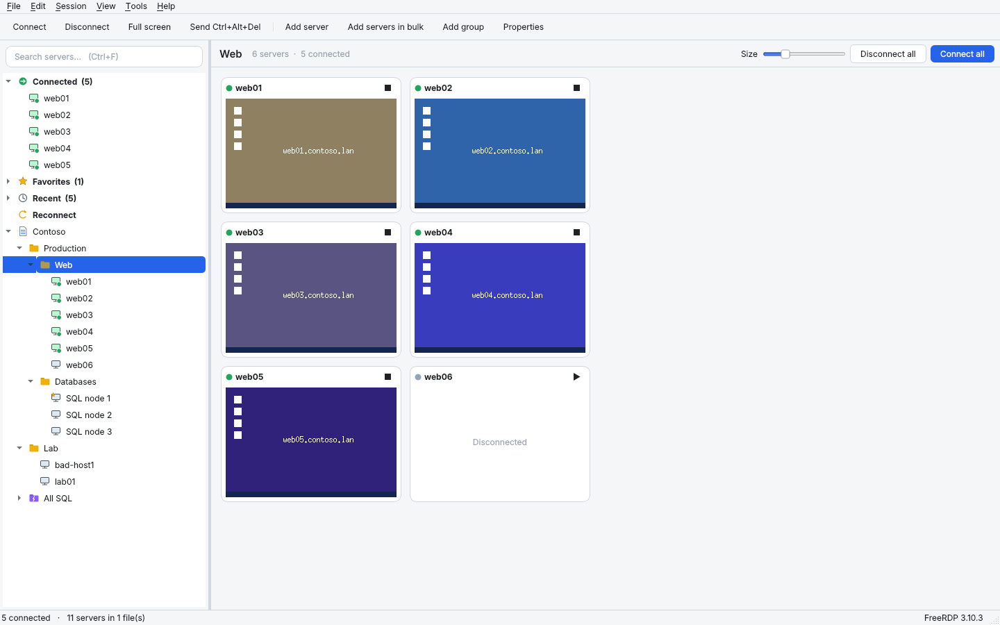

# engavenRDP

A tree-based, multi-session RDP connection manager for Linux, built on FreeRDP.
Organise hundreds of Windows servers in a tree, set credentials and settings once and
let them inherit, connect to a whole group with one click, and watch every session as a
live thumbnail — all inside one window. Sessions are real FreeRDP sessions embedded in the app.
Opens `.rdg` files from RDCMan.

See [`SPEC.md`](SPEC.md) for the full specification this code implements.



## Why I built this

I wanted Linux as my daily driver, but I still look after Windows machines and servers. The one
thing holding me back was a good way to keep all those RDP sessions organised in one window.
engavenRDP is what let me switch completely: I now work full time on Ubuntu 26.04 and still reach
every Windows machine I need.

If you are in the same position, I hope it saves you some time.

## Status and privacy

* A personal project, shared as is under the MIT licence in the hope it saves someone time.
  No support is promised; bug reports are welcome.
* Nothing leaves your computer: there is no telemetry, account or update check. The only network
  connections are to the servers you add. Saved passwords stay encrypted in your own files.

## Features

* **Tree of files → groups → servers**, nested to any depth, drag-and-drop, cut/copy/paste, duplicate.
* **Inheritance** for Logon credentials, Connection, Gateway, Display, Local resources, Security and
  Experience settings. The Properties dialog shows the inherited value *and where it comes from*;
  servers get an **Effective settings** tab.
* **Embedded sessions** (FreeRDP `/parent-window`), **live thumbnail grid** for any group
  (sessions scaled with `/smart-sizing`, click to select, double-click to open), **full screen**
  with a slide-down connection bar, choose the monitor, or open a session in an **external window**
  (for `/multimon` spans).
* **Special keys**: Ctrl+Alt+Del, Ctrl+Shift+Esc, Alt+Tab, Alt+F4, Win, Win+L, Win+R, Print Screen.
* **Virtual groups**: Connected, Favorites, Recent, and **Reconnect** (probes the RDP port and connects
  as soon as the server is back up — handy after reboots).
* **Smart groups**: rules on name / display name / host / comment / parent group.
* **Bulk add** with patterns (`web[01-10]`, `{prod,stage}-db[1-5]`, `node[a-f]`, `10.0.0.[1-20]`),
  **import from a text file**, **open `.rdg` files from RDCMan**, **export / import groups**.
* **Credential profiles** per file or global; passwords **encrypted at rest** with the desktop keyring
  (GNOME Keyring / KWallet via Secret Service) or a passphrase. Files that can't be decrypted on
  this machine still open — with a banner — and the encrypted values are preserved on save.
* Passwords reach FreeRDP via **stdin** (FreeRDP 3), never the process list.
* Search, status dots, keyboard shortcuts, auto-save, light/dark theme, command line.

## Install

1. **FreeRDP** (2.x or 3.x, X11 client):

   | Distro | Command |
   |---|---|
   | Ubuntu 24.04+ / Debian 13 | `sudo apt install freerdp3-x11 libxcb-cursor0` |
   | Older Ubuntu / Debian | `sudo apt install freerdp2-x11 libxcb-cursor0` |
   | Fedora | `sudo dnf install freerdp xcb-util-cursor` |
   | Arch | `sudo pacman -S freerdp xcb-util-cursor` |

2. **The app** (Python ≥ 3.10):

   ```bash
   ./install.sh          # pipx (or pip --user) + app-menu launcher
   engavenrdp --check        # verify FreeRDP, X11 and keyring are detected
   ```

   Or run from the source tree without installing:
   `pip install PySide6 cryptography python-xlib && python3 -m engavenrdp`

## Quick start

1. **File → New file…** (Ctrl+Shift+N), or open `examples/sample.erdp`, or open your Windows `.rdg`.
2. **Ctrl+G** to add a group, **Ctrl+N** to add a server, **Ctrl+B** for patterns.
3. Select the top-level file or a group → **Alt+Enter** → *Logon Credentials* → untick *Inherit*,
   enter user/domain/password (or pick a credential profile). Every server below inherits it.
4. Select a group and press **Connect all** — or double-click / Enter on a server.
5. **F11** for full screen; the bar at the top of the screen brings you back.

## Command line

```
engavenrdp [FILE ...]                     open files (in addition to last session's)
engavenrdp --connect web01,db02           connect by name, host or display name
engavenrdp --connect-group "Prod/Web"     connect every server in a group
engavenrdp --list FILE                    print a file's tree
engavenrdp --check                        show FreeRDP / X11 / keyring status
engavenrdp --theme dark --no-restore
```

## Wayland

FreeRDP embedding is an X11 feature. On a Wayland desktop engavenRDP automatically runs through
XWayland (`QT_QPA_PLATFORM=xcb`), which every mainstream distro ships. If Qt can only use Wayland,
sessions open in their own windows instead of being embedded — everything else works the same.

## File format

`.erdp` files are indented JSON (diff-friendly, safe to keep in git — passwords are
`enc:v1:…` Fernet tokens). Each node stores only the setting categories it overrides:

```json
{ "type": "group", "name": "Web",
  "settings": { "connection": { "port": 3390, "console": true } },
  "children": [ { "type": "server", "name": "web01", "host": "web01.example.lan" } ] }
```

Settings, preferences and global profiles live in `~/.config/engavenrdp/`.

## Architecture

```
engavenrdp/model/     nodes, settings schemas, inheritance resolver, JSON/.rdg storage, patterns, smart groups
engavenrdp/security/  Fernet + scrypt + Secret Service key storage
engavenrdp/backend/   RdpBackend interface, FreeRDP implementation (2.x/3.x), X11 helpers
engavenrdp/core/      Session state machine (QProcess), SessionManager (queue, reconnect), app state
engavenrdp/ui/        main window, tree, client area, thumbnails, full screen, dialogs, theme
```

To add another RDP engine, implement `backend.base.RdpBackend.build_command()` and register it
with `backend.register_backend()`; the UI only talks to that interface.

## Tests

```bash
pip install pytest && python3 -m pytest
```

Covers inheritance, profiles, patterns, smart groups, save/load round-trips, encryption (including
the "wrong machine" path), `.rdg` import, FreeRDP 2/3 argument generation and headless UI flows.
The embedding, thumbnails, full screen and special keys were tested end to end against a real
`xfreerdp3` 3.32 connected to a FreeRDP shadow server.

## Known limitations

* Thumbnails are live only for embedded sessions; external-window sessions show a status card.
* Special keys are delivered as synthetic X key events. FreeRDP accepts them, but if your
  setup ignores them, click into the session and use the keyboard directly.
* FreeRDP 2 receives the password as `/p:` (FreeRDP masks it immediately after start-up);
  FreeRDP 3 receives everything over stdin.
* FreeRDP 3's `/gateway:` syntax is comma-separated. Gateway passwords containing commas work,
  but ones containing a quote character or ending in a backslash cannot be passed and are refused.
* Windows `.rdg` passwords are DPAPI-encrypted and cannot be imported; you'll be prompted instead.

## Trademarks

engavenRDP is an independent project. It is not affiliated with, endorsed by or sponsored by
Microsoft. Windows is a trademark of the Microsoft group of companies; it is named here only
to describe what the software connects to and which file formats it can read.
